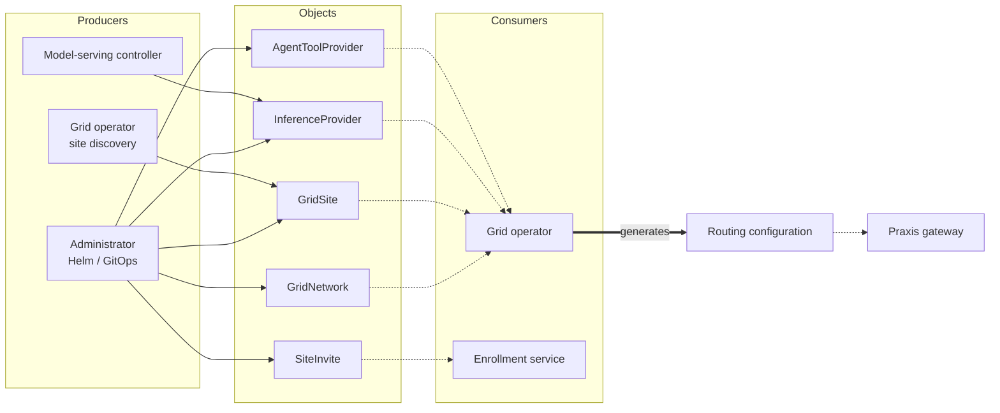

# CRD Ownership

Who writes and consumes AI Grid Network (AGN) objects. All installed CRDs use
grid.praxis.fast/v1alpha1 and are cluster-scoped.

## Producers and consumers

Solid arrows write spec. Dotted arrows read objects or generated configuration.
The table below identifies status writers. Site discovery and reconciliation
are roles within the same grid-operator process.

## Object index

| Object | Spec owner / writer | Status writer | Direct consumer |
| --- | --- | --- | --- |
| [GridNetwork](grid-network.md) | Administrator | Grid operator | Grid operator |
| [GridSite](grid-site.md) | Administrator or Grid discovery | Grid operator | Grid operator |
| [InferenceProvider](inference-provider.md) | Administrator or model-serving controller | Grid operator | Grid operator |
| [AgentToolProvider](agent-tool-provider.md) | Administrator | Grid operator | Grid operator |
| [SiteInvite](site-invite.md) | Administrator | Enrollment service | Enrollment service |

[AgentToAgentProvider](agent-to-agent-provider.md) is schema-only: it is absent
from the generated CRD installation and has no runtime controller or consumer.

## Ownership rules

- **Owner** means the authority for the desired values, not necessarily a
  Kubernetes ownerReference. Helm and GitOps apply administrator intent.
- Edit administrator-owned specs in their source configuration. For generated
  objects, edit the producing controller's input.
- Controllers maintain status and generated outputs on events and periodic
  reconciliation. Reconciliation does not rewrite every spec on a fixed interval.
- RBAC and admission control write access. Ownership alone does not prohibit
  administrator edits.

The gateway consumes generated routing configuration. It does not watch these
CRDs directly. See the [field reference](../crds.md) for API fields and examples.
